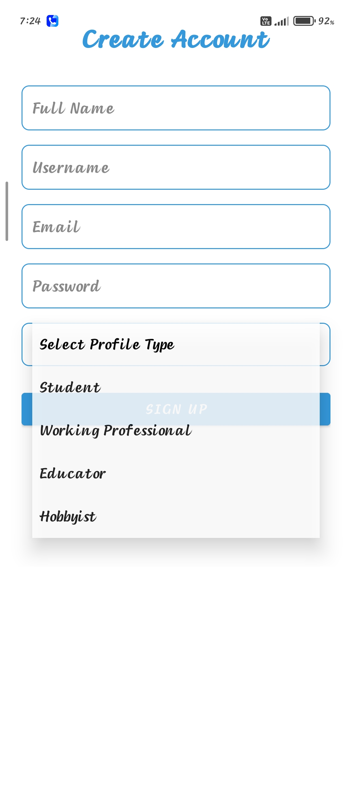
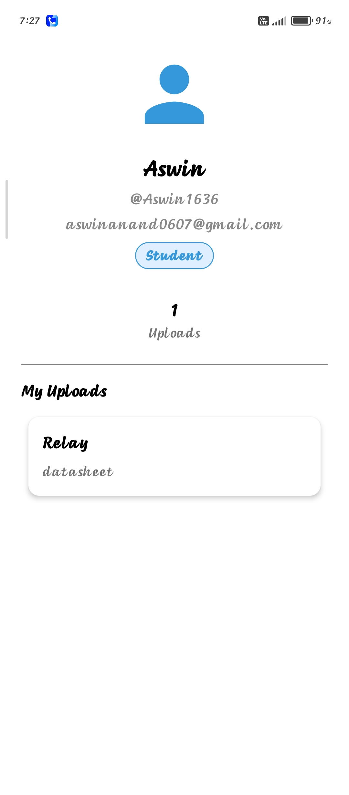
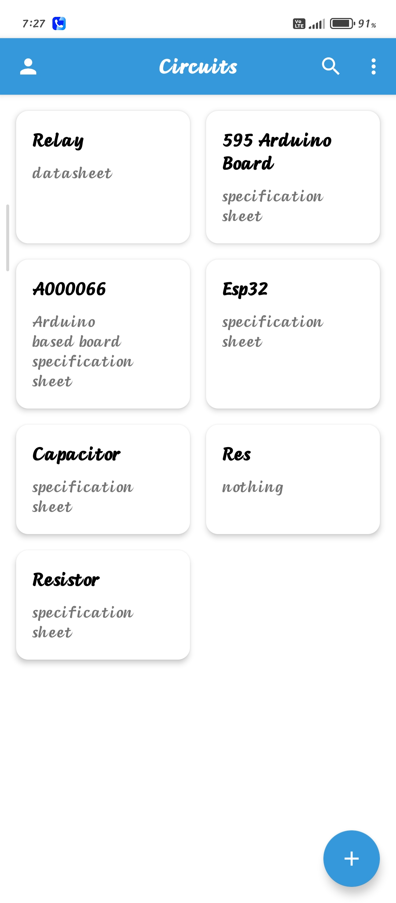
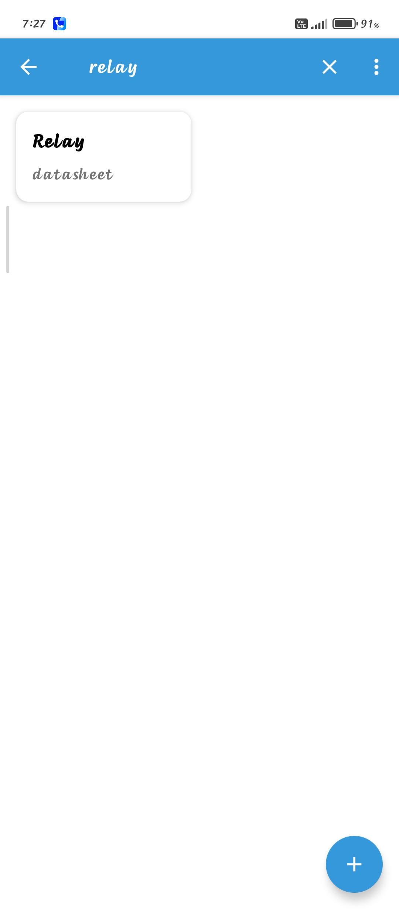
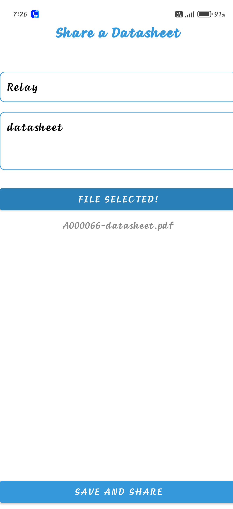

# Circuits — ECE Datasheet Sharing App

Circuits is a native Android application for Electronics and Communication Engineering (ECE) students, educators, hobbyists, and hardware engineers. It is designed to help users organize, discover, and share component datasheets and technical specification documents.

The app currently uses a **local SQLite database**. Accounts, datasheet metadata, and follow relationships are stored on the device; this is not yet a cloud-backed, cross-device repository.

## Features

- **Account creation and login** with user profile types such as Student, Working Professional, Educator, and Hobbyist.
- **Datasheet repository** with a grid-based list and search/filter experience.
- **Datasheet uploads** using Android's Storage Access Framework file picker.
- **Document opening** through compatible Android apps, with a `FileProvider` fallback for cached files.
- **User profiles** with upload information and follow/follower functionality.
- **Seven-day reciprocal access rule** intended to require a recent datasheet contribution to access shared datasheets.
- **Light and dark theme resources** and a branded splash screen.

> **Project status:** This repository describes a local-first project/prototype. Features that depend on actual cross-device sharing require a remote backend and are not provided by the current local SQLite architecture.

## Tech Stack

- **Language:** Kotlin
- **Android UI:** XML layouts, AndroidX, AppCompat, Material Components, RecyclerView
- **Local database:** SQLite through `SQLiteOpenHelper`
- **File access:** Android Storage Access Framework (SAF) and AndroidX `FileProvider`
- **Build system:** Gradle Kotlin DSL
- **Minimum Android version:** Android 7.0 (API 24)
- **Compile SDK / Target SDK:** API 36 / API 36 (as configured in the app module)

## Project Structure

```text
circuits/
├── app/
│   ├── build.gradle.kts
│   ├── proguard-rules.pro
│   └── src/
│       ├── main/
│       │   ├── AndroidManifest.xml
│       │   ├── java/com/example/circuits/
│       │   │   ├── SplashActivity.kt
│       │   │   ├── LoginActivity.kt
│       │   │   ├── SignupActivity.kt
│       │   │   ├── MainActivity.kt
│       │   │   ├── UploadActivity.kt
│       │   │   ├── ProfileActivity.kt
│       │   │   ├── ForgotPasswordActivity.kt
│       │   │   ├── data/
│       │   │   │   ├── User.kt
│       │   │   │   └── Datasheet.kt
│       │   │   ├── db/
│       │   │   │   └── DatabaseHelper.kt
│       │   │   └── ui/theme/
│       │   │       ├── Color.kt
│       │   │       ├── Theme.kt
│       │   │       ├── Type.kt
│       │   │       └── DatasheetAdapter.kt
│       │   └── res/
│       │       ├── anim/
│       │       ├── drawable/
│       │       ├── layout/
│       │       ├── menu/
│       │       ├── mipmap-*/
│       │       ├── values/
│       │       ├── values-night/
│       │       └── xml/
│       ├── test/
│       └── androidTest/
├── gradle/
│   ├── libs.versions.toml
│   └── wrapper/
├── build.gradle.kts
├── gradle.properties
├── gradlew
├── gradlew.bat
├── settings.gradle.kts
├── .gitignore
└── README.md
```

## Screenshots

<p align="center">
  
  
  
  
  
  
  
  
</p>

## Getting Started

### Requirements

- Android Studio with support for the project's Android Gradle Plugin
- JDK 11 or a compatible JDK required by the configured Gradle/Android toolchain
- Android SDK Platform 36
- An Android device or emulator running Android 7.0 (API 24) or newer

### Run the application

1. Clone this repository:

   ```bash
   git clone https://github.com/ASWINa1636/Circuits.git
   cd Circuits
   ```

   Replace the repository URL if you publish this project under a different repository name.

2. Open the project folder in Android Studio.
3. Allow Android Studio to sync Gradle and install any missing SDK components.
4. Select an Android emulator or connect a device with USB debugging enabled.
5. Run the `app` configuration.

You can also build from the project root with the Gradle wrapper:

**Windows (PowerShell):**
```powershell
.\gradlew.bat assembleDebug
```

**Linux / macOS:**
```bash
./gradlew assembleDebug
```

The debug APK is normally generated at:

```text
app/build/outputs/apk/debug/app-debug.apk
```

Build outputs are generated locally and should not be committed to the source repository.

## How It Works

### Local data storage

The `DatabaseHelper` class manages the SQLite database (`DatasheetDB`). The documented schema includes:

- **Users:** account/profile details and the latest upload timestamp.
- **Datasheets:** component name, description, stored content URI, uploader ID, and upload timestamp.
- **Follow:** follower/following relationships.

Datasheet file selection uses Android's document picker. Persisted URI permissions help the app retain access to selected documents, subject to the provider and file remaining available.

### Seven-day access rule

The intended rule allows access to datasheets when the signed-in user's latest upload timestamp is within the preceding seven days. Users whose access has expired are prompted to contribute another datasheet.

Because the current database is local to a device, this rule is a **local prototype mechanism**, not a server-enforced access-control system. A production multi-user service would need server-side identity, upload validation, and authorization.

## Important Security Notes

This project should be treated as a learning/demo project until its authentication and data handling are hardened.

- **Do not use real passwords with the current demo implementation.** The current source includes password storage/retrieval behavior that is not suitable for production. Passwords should be stored only as strong, salted password hashes on a properly secured backend; never display or retrieve a user's existing password.
- The current `ForgotPasswordActivity` contains demo-only logic that can display a stored password. Remove or replace this behavior with a secure password-reset flow before distributing the app.
- Local SQLite data is not a secure shared identity system. Local accounts and uploaded metadata do not automatically synchronize across devices.
- Only share documents you have permission to distribute. Respect copyright and the terms of the original datasheet publisher.
- Review Android manifest declarations and test all file-opening paths on supported Android versions before release.

## Current Limitations

- No remote backend or cloud synchronization is configured.
- Data and user accounts are local to the device.
- The seven-day rule is not enforceable across devices without a trusted backend.
- Password recovery is demo-only and must not be considered secure.
- A selected document's content URI refers to a document accessible through the device's storage provider; it does not upload the file to a central server.

## Roadmap

- Add a secure remote backend and authentication flow.
- Implement password hashing and token-based password reset.
- Add server-side upload validation and seven-day access enforcement.
- Support cloud synchronization and cross-device datasheet discovery.
- Add an in-app PDF preview and component tags/categories.
- Expand automated tests for authentication, access rules, database migrations, and file handling.

## Contributing

Contributions, bug reports, and feature suggestions are welcome. For substantial changes, open an issue first to discuss the proposed approach. Please do not commit credentials, local SDK paths, generated build files, or private user data.

## License

Circuits (ECEBuddy) is licensed under the **GNU General Public License v3.0 (GPL-3.0)**.

You are free to use, study, modify, and redistribute this software under the terms of the license. When distributing modified versions, you must comply with the applicable GPL-3.0 requirements, including providing corresponding source code where required.

See the [LICENSE](LICENSE) file for the complete license terms.


## Author

**Aswin**  
GitHub: [@ASWINa1636](https://github.com/ASWINa1636)
